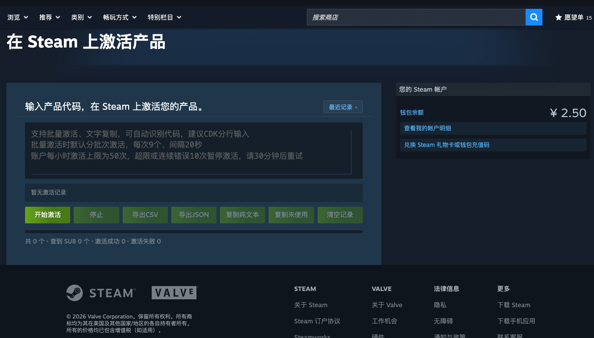
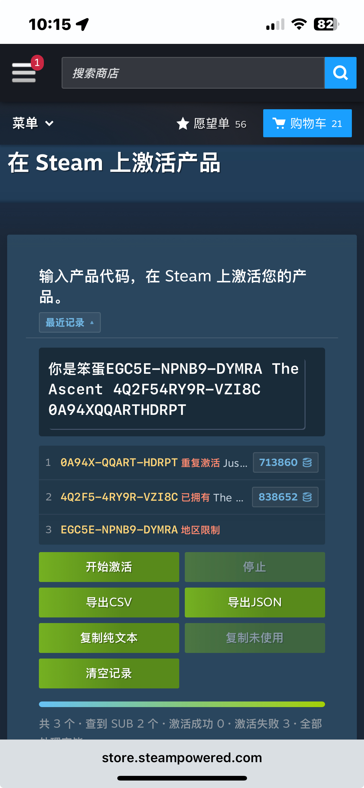
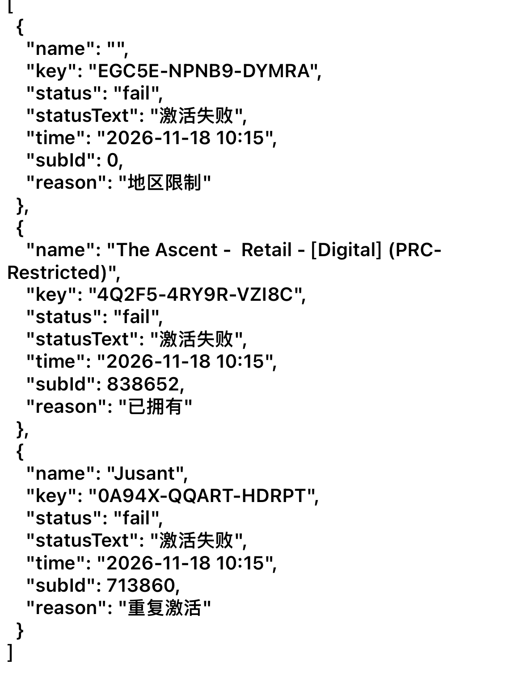

  <h1>
    
    Steam Registerkey Enhancer
  </h1>

# ✨ Project Introduction
This script runs on Steam's official key‑activation page and supports batch automatic CDK activation. It automatically extracts valid CDK from messy text, supports data export, and provides corresponding sub‑query capabilities.
# 📸 Screenshots
## Batch Activation Panel

Paste any text containing CDK into the input box. The script automatically uses global regular expressions to extract keys in the standard XXXXX‑XXXXX‑XXXXX format and filters invalid content.
## Activation Result Example

For all successfully activated or parsed keys (e.g. duplicate activation, already owned games), the SteamDB SubID will be displayed on the right. Click to jump to the detail page for quick lookup of package composition, included content and activation restrictions.
## Data Export Example

  
The script supports one‑click export of all activation records including game name, Key, status, timestamp, SubID and failure reason for archiving and reconciliation:
• Export CSV: for viewing in Excel
• Export JSON: structured raw data for further processing
• Copy Plain Text: quickly generate concise logs
• Copy Unused: extract all remaining unactivated keys with one click
• Clear Records: erase all local activation cache data
# 📥 Installation & Usage
> [!TIP]
> **Recommended script managers:**
> * **PC:** [Tampermonkey](http://tampermonkey.net/)
> * **iOS:** [Stay](https://apps.apple.com/cn/app/stay-for-safari-%E7%94%A8%E6%88%B7%E8%84%9A%E6%9C%AC%E4%B8%8E%E5%B9%BF%E5%91%8A%E6%8B%A6%E6%88%AA%E6%8F%92%E4%BB%B6/id1591620171)
> * **Steam Client:** [ScriptCat](https://scriptcat.org/zh‑CN)
## Installation Links
> * [Github](https://github.com/beerleexc/Steam‑Registerkey‑Enhancer/releases)
> * [GreasyFork](https://greasyfork.org/zh‑CN/scripts/605973‑steam‑registerkey‑enhancer)
> * [ScriptCat](https://scriptcat.org/zh‑CN/script‑show‑page/9153)
---
# 🐛 Report Issues
For bugs and feature suggestions please open [**Issues**](https://github.com/beerleexc/Steam‑Registerkey‑Enhancer/issues)
# 📝 Instructions
> [!note]
> **Notes:**
> * This script only calls official Steam APIs. It never uploads your keys, login credentials or personal data to any third‑party server. All activation records and runtime cache are stored locally in browser localStorage.
> * Clearing browser cache, uninstalling the script or using incognito mode will erase all records. Please export and back‑up important data in advance.
> * Steam enforces strict rate limits for key activation. Too many activations will trigger a maximum‑attempt error.

# ⚠️ Disclaimer
This script is intended for personal use only, to batch‑activate product keys you legally own.
According to the Steam Subscriber Agreement, automated script interaction is restricted. Do not use it for key resale, high‑frequency activation attempts or trying keys of unknown origin.
You are fully responsible for key legitimacy and any account risks.
---
# 🪁 Recommended Projects
## beerlee: Steam‑Wishlist‑Enhancer
Author: [beerlee](https://github.com/beerleexc)
- [GreasyFork](https://greasyfork.org/zh‑CN/scripts/605431)
- [GitHub](https://github.com/beerleexc/Steam‑Wishlist‑Enhancer)
## marioplus: Steam‑Price‑Converter
Author: [marioplus](https://github.com/marioplus)
- [GreasyFork](https://greasyfork.org/zh‑CN/scripts/452504)
- [GitHub](https://github.com/marioplus/steam‑price‑converter)
---
# 📄 License
This project is open‑sourced under the [**MIT License**](https://github.com/beerleexc/Steam‑Registerkey‑Enhancer/blob/main/LICENSE). Feel free to study and use it.

# 💗 Support Author
If you like this project please give it a ⭐Star (°∀°)ﾉ
You may also consider a donation (｀・ω・´)

Author: **beerlee**  
Version: **1.1.2**
