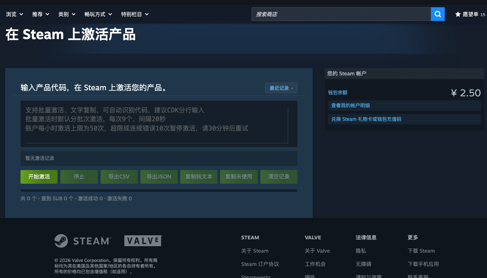
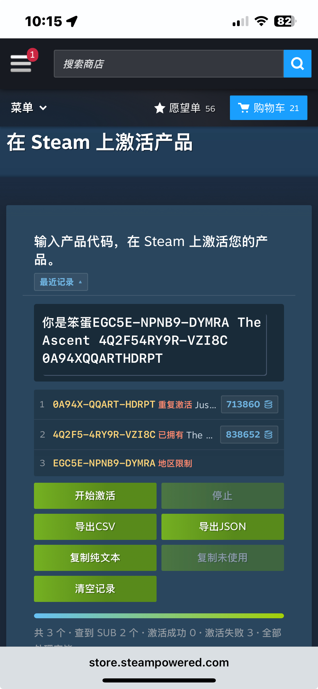

  <h1>
    
    Steam Registerkey Enhancer
  </h1>

# ✨ 项目简介

本脚本运行于 Steam 官方密钥激活页面，支持批量自动激活 CDK。自动识别杂乱文本中的有效CDK，支持数据导出，提供对应的 sub 查询功能。

# 📑 目录导航
# 效果展示
### 批量激活面板

###  激活状态解析

###  数据导出功能

效果展示

批量激活面板

激活状态解析

数据导出功能

📥 安装教程

1. 提前安装油猴脚本管理器（推荐 Violentmonkey / Tampermonkey）

2. 新建空白用户脚本，删除全部默认内容

3. 粘贴本项目完整脚本源码并保存

4. 浏览器登录 Steam 商店账号，访问密钥激活页面即可自动生效

# 📖 使用方法

## 基础使用

进入 Steam 密钥激活页面：https://store.steampowered.com/account/registerkey
将任意包含 CDK 的文本粘贴至输入框，脚本自动全局正则提取标准 XXXXX-XXXXX-XXXXX 格式密钥，自动过滤无效内容。

## 批量激活操作

• 点击 开始激活：自动分批提交密钥，智能限流，规避 Steam 风控

• 激活途中可随时点击 停止，剩余密钥保留队列，支持后续 继续激活

• 全程自动识别：激活成功 / 激活失败 / 等待激活 / 激活中 四种状态

## 数据导出与管理
  
  脚本支持一键导出所有激活记录，方便归档对账：

• 导出 CSV：适配 Excel 查看，包含游戏名、Key、状态、时间、SubID、失败原因

• 导出 JSON：结构化原始数据，适合二次处理

• 复制纯文本：快速生成简洁日志

• 复制未使用：一键提取所有未激活剩余密钥

• 清空记录：清空本地所有激活缓存数据

## SubID 查询

所有成功激活/解析出信息的密钥，右侧自动展示 SteamDB SubID，点击直达详情页，快速查询package构成、包含内容、激活限制。

# ⚠️ 注意事项

### Steam 官方风控限制

Steam 对密钥激活存在严格的激活频次限制，过量激活会触发次数上限报错。

### 本地数据存储

脚本仅请求 Steam 官方接口，不会上传你的密钥、登录凭证、个人数据至任何第三方服务器，所有激活记录、运行缓存仅保存在当前浏览器本地localStorage。
清理浏览器缓存、卸载脚本、无痕模式会清空所有记录，重要数据请提前导出备份。

### 页面兼容性

脚本独占 Steam 密钥激活页面 DOM，与其他 Steam 增强脚本可能存在 DOM 冲突。
界面异常、按钮消失时，临时关闭其他同类脚本即可恢复正常。

6. 安全说明

脚本仅请求 Steam 官方接口，不会上传你的密钥、登录凭证、个人数据至任何第三方服务器，全程本地运算、本地存储。

## 🐛 [问题反馈](#目录导航)
如有 Bug、功能建议，欢迎提交 [**Issues**](https://github.com/beerleexc/Steam-Registerkey-Enhancer/issues)

## 📝 [使用说明](#目录导航)

> [!note]
> **注意：**
> 价格与史低数据仅供参考，最终价格以 Steam 结算页为准。第三方数据可能缺失、延迟或存在地区/货币误差。
> 价格数据会自动存入脚本存储，普通价格缓存30分钟，最长保留24小时，汇率缓存24小时，特卖信息缓存6小时，减少重复网络请求。切换地区、页面刷新会重新拉取价格。
> 推荐愿望单总数在100时使用效果最佳，数量越多耗时越慢。默认一次性获取ID排序前100游戏的史低价格

---

## 📄 [开源协议](#目录导航)
本项目基于[**MIT License**](https://github.com/beerleexc/Steam-Registerkey-Enhancer/blob/main/LICENSE)开源，欢迎学习与使用。

作者：**beerlee**  
版本：**1.1.2**
